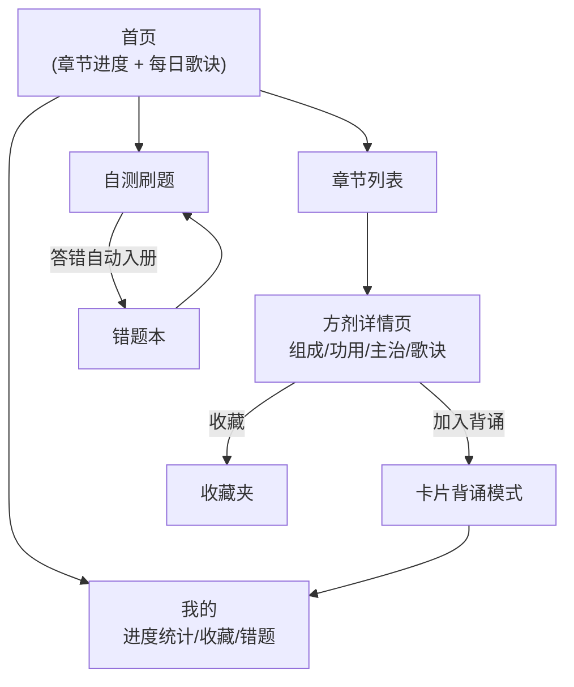
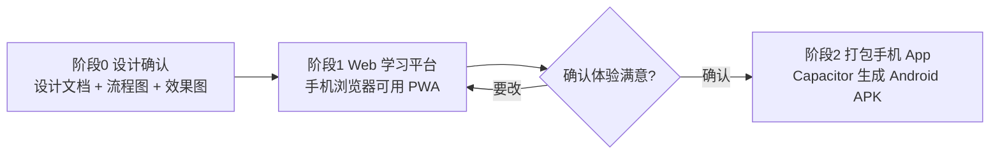

# 方剂学学习平台 · 设计文档

> 版本 v0.1（设计确认稿） · 2026-11-10
> 素材来源：《方剂学（表格汇总）》docx（19 章 / 175 首方剂）

---

## 一、产品定位

面向中医学生 / 备考者的**方剂学记忆工具**：以"学 → 背 → 测 → 复习"闭环帮助掌握方剂的组成、功用、主治与歌诀。

- 形态：移动优先（最终交付手机 App）
- 数据：本地离线，无需账号，打开即用
- 风格：新中式本草风（宣纸、朱砂、墨色、衬线宋体）

## 二、数据基础

### 2.1 章节与方剂统计（已从 docx 验证）

| 章 | 分类 | 方数 | 章 | 分类 | 方数 |
|---|---|---|---|---|---|
| 一 | 解表剂 | 16 | 十一 | 理气剂 | 12 |
| 二 | 泻下剂 | 8 | 十二 | 理血剂 | 12 |
| 三 | 和解剂 | 7 | 十三 | 治风剂 | 10 |
| 四 | 清热剂 | 20 | 十四 | 治燥剂 | 8 |
| 五 | 祛暑剂 | 5 | 十五 | 祛湿剂 | 19 |
| 六 | 温里剂 | 8 | 十六 | 祛痰剂 | 9 |
| 七 | 补益剂 | 18 | 十七 | 消食剂 | 5 |
| 八 | 固涩剂 | 9 | 十八 | 驱虫剂 | 1 |
| 九 | 安神剂 | 3 | 十九 | 涌吐剂 | 1 |
| 十 | 开窍剂 | 4 | **合计** | | **175** |

### 2.2 数据结构（formulas.json）

```jsonc
{
  "chapters": [
    {
      "id": 1,
      "name": "解表剂",
      "sections": ["辛温解表", "辛凉解表", "扶正解表"],
      "formulas": [
        {
          "id": "mahuang-tang",
          "name": "麻黄汤",
          "source": "伤寒论",
          "section": "辛温解表",
          "composition": [
            { "role": "君", "herbs": "麻黄" },
            { "role": "臣", "herbs": "桂枝" },
            { "role": "佐", "herbs": "杏仁" },
            { "role": "佐使", "herbs": "甘草" }
          ],
          "function": "发汗解表，宣肺平喘。",
          "indication": "外感风寒表实证。恶寒发热，头身疼痛……",
          "verse": "麻黄汤中臣桂枝，杏仁甘草四般施……",
          "note": "因其为辛温发汗之峻剂……"
        }
      ]
    }
  ]
}
```

用户数据（localStorage）：`learned[]`、`favorites[]`、`wrongQuestions[]`、`cardMemory{formulaId: {level, nextReview}}`、`dailyStreak`。

## 三、功能模块

| 模块 | 页面 | 功能 |
|---|---|---|
| 学习 | 首页 / 章节列表 / 方剂详情 | 章节进度网格；详情页展示君臣佐使组成表、功用、主治、歌诀、注意 |
| 背诵 | 卡片模式 | 翻面卡（歌诀填空 / 方名→组成）；认识/模糊/不认识三档，简化艾宾浩斯间隔复习（10 分钟 / 明天 / 3 天） |
| 刷题 | 自测 / 错题本 | 自动出题：组成→方名、方名→君药、功用→方名、主治→方名、歌诀填空；答错自动入错题本 |
| 我的 | 统计页 | 总进度环、章节掌握度、收藏、错题、连续学习天数 |

## 四、流程图

### 4.1 用户流程



### 4.2 数据流


### 4.3 分阶段路线



## 五、界面设计规范

### 5.1 设计令牌

| 令牌 | 值 | 用途 |
|---|---|---|
| `--paper` | `#f4eee1` | 宣纸底色 |
| `--card` | `#faf6ea` | 卡片 |
| `--ink` | `#2b2620` | 正文墨色 |
| `--ink-light` | `#7d7466` | 次要文字 |
| `--cinnabar` | `#b03a2e` | 朱砂主色（印章、按钮、进度） |
| `--amber` | `#c08a2d` | "模糊"档 |
| `--bamboo` | `#5f7050` | "认识"档、佐使标签 |
| 字体 | Noto Serif SC / 宋体 | 全局衬线 |

### 5.2 效果图（mockups/ 目录，390×844 @2x）

| 文件 | 界面 |
|---|---|
| `mockups/1-home.png` | 首页：问候、每日歌诀卡、章节进度网格、底部 Tab |
| `mockups/2-detail.png` | 方剂详情：出处、君臣佐使组成表、功用主治、歌诀高亮、加入背诵 |
| `mockups/3-flashcard.png` | 背诵卡片：歌诀填空翻面卡 + 三档记忆按钮 |
| `mockups/4-quiz.png` | 刷题：单选题 + 即时反馈 |
| `mockups/5-profile.png` | 我的：进度环、章节掌握度、错题本/收藏 |

> 效果图以真实 HTML/CSS 按设计规范渲染截图，开发阶段可按 Vant 组件 1:1 还原。HTML 源文件同目录可改可复看。

## 六、技术选型（阶段 1 / 2）

- **阶段 1**：Vue 3 + Vite + Vant 4 + Pinia + vue-router；`vite-plugin-pwa` 支持"添加到主屏幕"
- **数据管线**：Python 脚本解析 docx → `formulas.json`（构建期产物，运行时只读 JSON）
- **阶段 2（需再次确认）**：Capacitor 打包 Android APK，代码零重写；iOS 需 Mac 另议

## 七、待确认事项

1. 效果图风格/布局是否满意（可逐页提修改意见）
2. 阶段 1 是否按 Vue3 + Vant 技术栈开工
